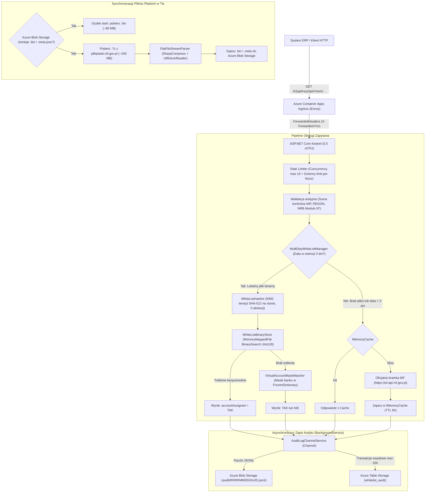

# Biała Lista Podatników VAT API (.NET 10 / Azure Container Apps)

Wysokowydajny, zoptymalizowany pod kątem minimalnego zużycia pamięci i CPU mikroserwis w **.NET 10 (ASP.NET Core Minimal API)**, kompatybilny 1:1 z oficjalnymi endpointami weryfikacji rachunków bankowych (**metoda `check`**) Wykazu Podatników VAT Ministerstwa Finansów (MF).

Projekt został zaprojektowany z myślą o hostingu w środowisku bezserwerowym **Azure Container Apps** (plan Consumption: `0.5 vCPU`, `1.0 GiB RAM`, autoskalowanie `0..2`) oraz bezpośredniej integracji z systemami księgowo-finansowymi i ERP (np. Comarch, SAP, Enova365, Symfonia).

---

## 1. Kluczowe cechy i niezmienniki architektoniczne

* **Zero alokacji w gorącej ścieżce (Hot-Path Zero-Alloc):**
  Obliczanie 5000 iteracji SHA-512 (`WhiteListHasher.ComputeTruncatedHash`) odbywa się wyłącznie na stosie (`stackalloc byte[64]`, `stackalloc byte[128]`) z użyciem `SHA512.HashData`. Brak alokacji obiektów na stercie GC w trakcie obsługi zapytania weryfikacyjnego.
* **Reprezentacja skrótów i wyszukiwanie binarne (`UInt128`):**
  Skróty SHA-512 z pliku płaskiego MF są obcinane do pierwszych 16 bajtów (128 bitów) i zapisywane jako `UInt128` w formacie **Big-Endian**, co zachowuje identyczny porządek sortowania jak tekst szesnastkowy. Pliki `.bin` są mapowane do pamięci wirtualnej przez `MemoryMappedFile` i przeszukiwane przez `ReadOnlySpan<UInt128>.BinarySearch()` w czasie poniżej 1 µs.
* **Wyszukiwanie masek rachunków wirtualnych:**
  Maski rachunków wirtualnych są grupowane po 4-cyfrowym kodzie rozliczeniowym banku w `FrozenDictionary<uint, string[]>`. Sprawdzane są wyłącznie maski przypisane do danego banku, eliminując zbędne hashowanie.
* **Strumieniowe przetwarzanie pliku płaskiego:**
  Archiwa `.7z` z serwerów MF są rozpakowywane w locie (`SharpCompress 0.48.0`) i parsowane strumieniowo przez `Utf8JsonReader` na buforze 64 KB z `ArrayPool<byte>.Shared`.
* **Retencja 3 dni i Fallback do API MF:**
  Aplikacja utrzymuje retencję lokalnych plików `.bin` dla 3 ostatnich dni wg strefy `Europe/Warsaw`. Jeśli zapytanie dotyczy starszej daty lub plik na bieżący dzień nie został jeszcze opublikowany przez MF po północy, następuje automatyczne odpytanie oficjalnego API MF z buforowaniem w `IMemoryCache` (TTL 6h).
* **Niezależność od nagłówków HTTP:**
  Systemy ERP nie muszą przesyłać własnych nagłówków (np. `X-Api-Key`). Klucz klienta może być przekazany w ścieżce URL (`/k/{apiKey}/api/check/...`), parametrze query (`?apiKey=...`) lub rozliczany po adresie IP klienta (z pełną obsługą `X-Forwarded-For` za Ingress ACA).
* **Asynchroniczny audyt należytej staranności:**
  Każda weryfikacja generuje unikalny `requestId` i trafia do nieblokującego kanału `Channel<AuditLogEntry>`, który zapisuje paczki do **Azure Blob Storage** (`.jsonl`) oraz transakcyjnie do **Azure Table Storage** jako dowód dochowania należytej staranności przed organami skarbowymi.

---

## 2. Diagram Architektury



---

## 3. Specyfikacja API

### 3.1. Weryfikacja po numerze NIP

```http
GET /api/check/nip/{nip}/bank-account/{bankAccount}?date=YYYY-MM-DD
GET /k/{apiKey}/api/check/nip/{nip}/bank-account/{bankAccount}?date=YYYY-MM-DD
```

* **Parametry ścieżki:**
  - `apiKey` *(opcjonalny)* – identyfikator klienta zdefiniowany w konfiguracji (`appsettings.json` lub zmienna `CLIENT_QUOTAS`).
  - `nip` – 10-cyfrowy numer NIP (walidowany algorytmem sumy kontrolnej MF).
  - `bankAccount` – 26-cyfrowy numer rachunku bankowego w formacie NRB (bez liter `PL`, bez spacji; walidowany algorytmem Modulo 97).
* **Parametry query:**
  - `date` *(opcjonalny)* – data weryfikacji w formacie `YYYY-MM-DD` (domyślnie: bieżąca data wg czasu polskiego `Europe/Warsaw`).
  - `apiKey` *(opcjonalny)* – alternatywny sposób przekazania klucza klienta w query stringu (`?apiKey=...`).

#### Przykłady żądań:
```bash
# 1. Sprawdzenie z domyślnym limitem IP (na bieżący dzień)
curl -X GET "http://localhost:8080/api/check/nip/5260250995/bank-account/02102010260000140201648043"

# 2. Sprawdzenie na konkretną datę
curl -X GET "http://localhost:8080/api/check/nip/5260250995/bank-account/02102010260000140201648043?date=2026-10-14"

# 3. Z kluczem klienta w ścieżce URL (dla systemów ERP/FK bez własnych nagłówków)
curl -X GET "http://localhost:8080/k/klucz-klienta-standard/api/check/nip/5260250995/bank-account/02102010260000140201648043"

# 4. Z kluczem klienta w parametrze query
curl -X GET "http://localhost:8080/api/check/nip/5260250995/bank-account/02102010260000140201648043?apiKey=klucz-klienta-standard"
```

#### Przykład odpowiedzi (200 OK):
```json
{
  "result": {
    "accountAssigned": "TAK",
    "requestDateTime": "14-10-2026 19:30:15",
    "requestId": "a7b3c2e1f4094d128b"
  }
}
```

* `accountAssigned`: `"TAK"` (rachunek figuruje na Białej Liście) lub `"NIE"` (brak powiązania).
* `requestId`: unikalny identyfikator zapytania służący jako dowód należytej staranności w celach audytowych.

---

### 3.2. Weryfikacja po numerze REGON

```http
GET /api/check/regon/{regon}/bank-account/{bankAccount}?date=YYYY-MM-DD
GET /k/{apiKey}/api/check/regon/{regon}/bank-account/{bankAccount}?date=YYYY-MM-DD
```

* **Parametry ścieżki:**
  - `regon` – 9- lub 14-cyfrowy numer REGON podmiotu (walidowany wagami kontrolnymi).
  - Pozostałe parametry i format odpowiedzi identyczne jak dla NIP.

#### Przykład żądania:
```bash
curl -X GET "http://localhost:8080/api/check/regon/012100784/bank-account/02102010260000140201648043?date=2026-10-14"
```

---

### 3.3. Sonda diagnostyczna i gotowości (`/healthz`)

```http
GET /healthz
```

Służy jako **Readiness** oraz **Liveness probe** w Azure Container Apps / Kubernetes:
* **`200 OK` (Healthy):** Zwracany, gdy co najmniej jeden dzień danych został w pełni załadowany do pamięci.
* **`503 Service Unavailable` (Starting):** Zwracany w trakcie rozruchu kontenera, zanim dane zostaną pobrane i zmapowane. Dzięki temu Ingress nie kieruje ruchu produkcyjnego do niegotowego kontenera.

```json
{
  "status": "Healthy",
  "loadedDates": ["20261014", "20261013", "20261012"],
  "memoryAllocatedMb": 24.51,
  "machineTime": "2026-10-14T17:35:00.0000000Z"
}
```

---

### 3.4. Kody błędów

Format i kody błędów są zgodne ze specyfikacją techniczną Ministerstwa Finansów:

| Kod błędu | Status HTTP | Opis |
| :--- | :--- | :--- |
| `WL-113` | `400 Bad Request` | Niepoprawny numer NIP (błędna długość, znaki lub suma kontrolna). |
| `WL-114` | `400 Bad Request` | Niepoprawny numer REGON (błędna długość 9/14 cyfr lub suma kontrolna). |
| `WL-115` | `400 Bad Request` | Niepoprawny rachunek bankowy NRB (błędna długość 26 cyfr lub suma kontrolna Modulo 97). |
| `WL-111` | `400 Bad Request` | Niepoprawny format daty (wymagany `YYYY-MM-DD`). |
| `RATE-LIMIT` | `429 Too Many Requests` | Przekroczono dzienny limit zapytań dla danego klucza/IP lub serwer przetwarza więcej niż 16 równoległych zapytań. |
| `WL-500` | `502 Bad Gateway` | Błąd komunikacji z oficjalną bramką Ministerstwa Finansów w trybie Fallback. |

---

## 4. Konfiguracja i zmienne środowiskowe

Konfiguracja aplikacji może być przekazywana przez plik `appsettings.json` lub bezpośrednio przez zmienne środowiskowe kontenera:

| Zmienna środowiskowa | Domyślna wartość | Opis |
| :--- | :--- | :--- |
| `MF_API_BASE_URL` | `https://wl-api.mf.gov.pl/` | Adres oficjalnego API Wykazu Podatników VAT do zapytań Fallback. |
| `BLOB_STORAGE_URI` | *(brak)* | URI kontenera Azure Blob Storage z wygenerowanymi plikami `.bin` i logami audytu. |
| `TABLE_STORAGE_URI` | *(brak)* | URI usługi Azure Table Storage do logowania audytowego. |
| `AUDIT_TABLE_NAME` | `whitelist_audit` | Nazwa tabeli w Table Storage. |
| `CLIENT_QUOTAS` | `klucz-klienta-standard:1000,klucz-klienta-premium:50000` | Dzienne limity zapytań per klucz. Format: `klucz1:1000,klucz2:50000` (dozwolone są też `;` i `=`). |
| `DOTNET_GCHeapHardLimit` | `0x30000000` (768 MB) | Twardy limit pamięci sterty GC (ochrona przed OOM w kontenerze 1.0 GiB). |
| `TZ` | `Europe/Warsaw` | Strefa czasowa kontenera. |

### 4.1. Klucze klientów i limity dzienne

Wpis w `CLIENT_QUOTAS` przypisuje nazwę/klucz klienta do maksymalnej liczby zapytań na dobę. Ten sam klucz należy przekazywać w ścieżce URL `/k/{apiKey}/...` albo jako parametr `?apiKey=...`. Na przykład konfiguracja:

```text
CLIENT_QUOTAS="erp-standard:5000,erp-premium:50000,biuro-abc:12000"
```

oznacza limit 5000 zapytań dziennie dla `erp-standard`, 50000 dla `erp-premium` i 12000 dla `biuro-abc`. Separatorem par może być przecinek lub średnik, a klucz i liczbę można rozdzielić dwukropkiem albo znakiem `=`. Używaj osobnego, niepowtarzalnego klucza dla każdego klienta. Przykład wywołania:

```bash
curl "https://<adres-api>/k/biuro-abc/api/check/nip/5260250995/bank-account/02102010260000140201648043"
```

Limity można ustawić w sekcji `ClientQuotas` pliku `appsettings.json` albo przekazać jako `CLIENT_QUOTAS`. Zmienna środowiskowa nadpisuje limit o tej samej nazwie; pozostałe wpisy z `appsettings.json` nadal obowiązują. Jeżeli ustawiasz limity wyłącznie przez zmienną, usuń lub zmień domyślne wpisy w `appsettings.json`, jeśli nie mają być aktywne.

W Azure Container Apps można zmienić konfigurację istniejącej aplikacji poleceniem:

```bash
az containerapp update \
  --name ca-whitelist-api \
  --resource-group rg-whitelist-pl \
  --set-env-vars 'CLIENT_QUOTAS=erp-standard:5000,erp-premium:50000,biuro-abc:12000'
```

Klucz służy do identyfikacji limitu, **nie jest uwierzytelnieniem ani ochroną dostępu do API**: aplikacja nie sprawdza, czy wywołujący ma prawo użyć danego klucza. Nie umieszczaj w nim haseł ani innych sekretów; jeśli API wymaga kontroli dostępu, skonfiguruj ją dodatkowo na poziomie ingressu lub warstwy uwierzytelniania.

---

## 5. Wdrożenie w Azure Container Apps

### 5.1. Wymagania dotyczące zasobów i bezpieczeństwa
* **vCPU:** `0.5`
* **RAM:** `1.0 GiB`
* **Skalowanie:** `0..2` replik (skalowanie do zera przy braku ruchu – zerowy koszt w nocy).
* **Tożsamość zarządzana (Managed Identity):**
  Aplikacja nie przechowuje kluczy dostępowych do Storage. Używa tożsamości `SystemAssigned` kontenera i biblioteki `Azure.Identity (DefaultAzureCredential)`. Wymagane role RBAC:
  - `Storage Blob Data Contributor` (odczyt/zapis cache `.bin` i logów `.jsonl`)
  - `Storage Table Data Contributor` (zapis audytu transakcji do Azure Tables)

---

### 5.2. Szybkie wdrożenie automatyczne (Skrypty wdrożeniowe)

W repozytorium przygotowano gotowe skrypty automatyzujące pełną procedurę wdrożenia (tworzenie grupy zasobów, Storage Account, Bloba `whitelist`, tabeli `whitelist_audit`, Container App oraz uprawnień RBAC dla Managed Identity):

#### Dla systemu Linux / macOS (Bash):
```bash
chmod +x scripts/deploy-azure.sh
./scripts/deploy-azure.sh
```
Opcjonalna parametryzacja:
```bash
RESOURCE_GROUP="rg-mojafirma-whitelist" \
LOCATION="polandcentral" \
CONTAINER_APP_NAME="ca-whitelist-api" \
STORAGE_ACCOUNT="stmojafirmabialalista" \
CLIENT_QUOTAS="erp:5000,biuro-abc:12000" \
./scripts/deploy-azure.sh
```
Skrypt tworzy konto Azure Storage (Blob + Table), kontener `whitelist` i tabelę audytu, a następnie konfiguruje adresy URI oraz uprawnienia Managed Identity. Podaj `STORAGE_ACCOUNT`, aby ustalić nazwę tworzonego konta; pominięcie zmiennej powoduje wygenerowanie nazwy unikalnej. `CLIENT_QUOTAS` pozwala przekazać własne klucze i dzienne limity podczas instalacji; wartości domyślne to `erp-standard:5000,erp-premium:50000`.

Parametr `DEPLOY_MODE` wybiera sposób wdrożenia:
* `source` (domyślnie) – buduje i wdraża projekt ze źródeł przez `az containerapp up`.
* `image` – wdraża istniejący obraz z ACR lub Docker Hub. Obraz musi już być opublikowany.
* `build-image` – buduje obraz na podstawie `Dockerfile` przez `az acr build`, publikuje go w ACR i wdraża. Azure wykonuje budowanie w ACR, więc lokalny Docker nie jest wymagany.

Przykłady dla Bash:
```bash
# Gotowy obraz w istniejącym ACR
DEPLOY_MODE=image \
IMAGE="mojrejestr.azurecr.io/whitelist-api:v1.2.0" \
ACR_RESOURCE_GROUP="rg-rejestru" \
./scripts/deploy-azure.sh

# Zbudowanie, opublikowanie i wdrożenie nowego obrazu
DEPLOY_MODE=build-image \
ACR_NAME="mojrejestr" \
ACR_RESOURCE_GROUP="rg-rejestru" \
IMAGE_TAG="v1.2.0" \
./scripts/deploy-azure.sh

# Wdrożenie obrazu opublikowanego przez GitHub Actions na Docker Hub
DEPLOY_MODE=image \
IMAGE="docker.io/mojekonto/whitelist-api:sha-<commit>" \
./scripts/deploy-azure.sh
```

Odpowiedniki parametrów PowerShell to `-DeployMode image -Image "mojrejestr.azurecr.io/whitelist-api:v1.2.0" -AcrResourceGroup "rg-rejestru"` oraz `-DeployMode build-image -AcrName "mojrejestr" -AcrResourceGroup "rg-rejestru" -ImageTag "v1.2.0"`. Docker Hub można wdrożyć przez `-DeployMode image -Image "docker.io/mojekonto/whitelist-api:sha-<commit>"`. Przy `build-image` skrypt utworzy rejestr ACR w podanej grupie zasobów, jeśli jeszcze nie istnieje; jego nazwa musi być globalnie unikalna. Dla ACR skrypt nadaje dedykowanej Managed Identity rolę `AcrPull`; Docker Hub używa publicznego pulla albo podanych poświadczeń. `ACR_RESOURCE_GROUP` (`-AcrResourceGroup`) domyślnie przyjmuje wartość `RESOURCE_GROUP` (`-ResourceGroup`).

#### Budowanie i publikowanie na Docker Hub przez GitHub Actions
Workflow `.github/workflows/dockerhub-publish.yml` uruchamia testy, buduje obraz z `Dockerfile` i publikuje go na Docker Hub. Dodaj w ustawieniach repozytorium GitHub sekrety `DOCKERHUB_USERNAME` oraz `DOCKERHUB_TOKEN` (token Docker Hub z prawem zapisu). Push do `main` publikuje tag `latest` i tag SHA commita; tag `v*` publikuje dodatkowo tag wersji. Obraz budowany jest dla `linux/amd64`, zgodnie z hostowanym środowiskiem Azure Container Apps.

Po publikacji można uruchomić skrypt wdrożeniowy bez checkoutu projektu, podając jedynie opublikowany obraz oraz wymagane parametry Azure. Do publicznego repozytorium Docker Hub nie potrzeba credentiali. Dla prywatnego repozytorium ustaw `DOCKERHUB_USERNAME` i `DOCKERHUB_TOKEN` w środowisku uruchomienia skryptu albo użyj parametrów PowerShell `-DockerHubUsername` i `-DockerHubToken`; token nie jest wypisywany przez skrypt. Skrypt nadal potrzebuje Azure CLI (`az`) i zalogowanej subskrypcji.

#### Dla systemu Windows (PowerShell):
Skrypt `scripts/deploy-azure.ps1` działa w PowerShell 5.1 oraz PowerShell 7+:
```powershell
.\scripts\deploy-azure.ps1
```
Opcjonalna parametryzacja przez parametry polecenia:
```powershell
.\scripts\deploy-azure.ps1 `
    -ResourceGroup "rg-mojafirma-whitelist" `
    -Location "polandcentral" `
    -ContainerAppName "ca-whitelist-api" `
    -StorageAccount "stmojafirmabialalista" `
    -ClientQuotas "erp:5000,biuro-abc:12000"
```
Parametr `-StorageAccount` ustala nazwę tworzonego konta Storage. Gdy go pominiesz, skrypt wygeneruje nazwę unikalną. Konto, kontener Blob i tabela audytu są tworzone automatycznie.

---

### 5.3. Wdrożenie krok po kroku (Azure CLI)

Jeśli wolisz wykonać poszczególne kroki ręcznie:

```bash
# 1. Zmienne
RESOURCE_GROUP="rg-whitelist-pl"
LOCATION="polandcentral"
CONTAINER_APP_NAME="ca-whitelist-api"
ENVIRONMENT_NAME="cae-whitelist-env"
STORAGE_ACCOUNT="stwhitelist$RANDOM"

# 2. Grupa zasobów
az group create --name $RESOURCE_GROUP --location $LOCATION

# 3. Konto Azure Storage (Blob + Table)
az storage account create \
  --name $STORAGE_ACCOUNT \
  --resource-group $RESOURCE_GROUP \
  --location $LOCATION \
  --sku Standard_LRS \
  --kind StorageV2 \
  --allow-blob-public-access false

STORAGE_ID=$(az storage account show --name $STORAGE_ACCOUNT --resource-group $RESOURCE_GROUP --query id -o tsv)

az storage container create --name whitelist --account-name $STORAGE_ACCOUNT --auth-mode login
az storage table create --name whitelist_audit --account-name $STORAGE_ACCOUNT --auth-mode login

# 4. Środowisko Azure Container Apps
az containerapp env create \
  --name $ENVIRONMENT_NAME \
  --resource-group $RESOURCE_GROUP \
  --location $LOCATION

# 5. Utworzenie aplikacji z tożsamością Managed Identity
az containerapp create \
  --name $CONTAINER_APP_NAME \
  --resource-group $RESOURCE_GROUP \
  --environment $ENVIRONMENT_NAME \
  --source . \
  --target-port 8080 \
  --ingress external \
  --cpu 0.5 \
  --memory 1.0Gi \
  --min-replicas 0 \
  --max-replicas 2 \
  --system-assigned \
  --env-vars \
    BLOB_STORAGE_URI="https://${STORAGE_ACCOUNT}.blob.core.windows.net/whitelist" \
    TABLE_STORAGE_URI="https://${STORAGE_ACCOUNT}.table.core.windows.net/" \
    AUDIT_TABLE_NAME="whitelist_audit" \
    CLIENT_QUOTAS="erp:5000,biuro-abc:12000" \
    TZ="Europe/Warsaw" \
    DOTNET_GCHeapHardLimit="0x30000000"

# 6. Nadanie uprawnień RBAC tożsamości kontenera
PRINCIPAL_ID=$(az containerapp identity show \
  --name $CONTAINER_APP_NAME \
  --resource-group $RESOURCE_GROUP \
  --query principalId -o tsv)

az role assignment create \
  --assignee $PRINCIPAL_ID \
  --role "Storage Blob Data Contributor" \
  --scope $STORAGE_ID

az role assignment create \
  --assignee $PRINCIPAL_ID \
  --role "Storage Table Data Contributor" \
  --scope $STORAGE_ID

# 7. Restart rewizji kontenera (aby załadował uprawnienia RBAC)
az containerapp revision restart \
  --name $CONTAINER_APP_NAME \
  --resource-group $RESOURCE_GROUP \
  --revision $(az containerapp show -n $CONTAINER_APP_NAME -g $RESOURCE_GROUP --query properties.latestRevisionName -o tsv)
```

---

### 5.4. Weryfikacja wdrożenia

1. **Pobranie adresu URL:**
   ```bash
   APP_URL=$(az containerapp show -n $CONTAINER_APP_NAME -g $RESOURCE_GROUP --query properties.configuration.ingress.fqdn -o tsv)
   echo "Adres API: https://${APP_URL}"
   ```

2. **Sonda gotowości:**
   ```bash
   curl -i "https://${APP_URL}/healthz"
   ```

3. **Weryfikacja rachunku bankowego (NIP):**
   ```bash
   curl -i "https://${APP_URL}/k/erp-standard/api/check/nip/5260250995/bank-account/02102010260000140201648043"
   ```

---

### 5.5. Ciągła integracja i wdrożenie (CI/CD)
W katalogu `.github/workflows/` przygotowane są dwa przepływy GitHub Actions:
- **`ci.yml`**: Uruchamiany przy każdym Pull Requeście i wypchnięciu do gałęzi `main`. Przywraca pakiety, kompiluje projekt w konfiguracji `Release` i uruchamia 58 testów jednostkowych xUnit z raportem pokrycia kodu.
- **`deploy.yml`**: Uruchamiany automatycznie po przejściu testów na gałęzi `main` – loguje się do Azure przy użyciu tożsamości federacyjnej OIDC (`azure/login@v2`) i wdraża nową wersję do Azure Container Apps.

---

## 6. Uruchomienie lokalne i testy

### Wymagania:
* [.NET 10 SDK](https://dotnet.microsoft.com/download/dotnet/10.0)

### Uruchomienie testów jednostkowych:
```bash
dotnet test
```

### Uruchomienie serwera lokalnie:
```bash
dotnet run --project WhiteListApi.csproj
```
Dzięki profilowi w `Properties/launchSettings.json` aplikacja uruchamia się bezpośrednio pod adresem:
`http://localhost:8080`

> [!NOTE]
> Zaraz po uruchomieniu endpoint diagnostyczny `GET http://localhost:8080/healthz` zwraca status **HTTP 503 Service Unavailable** (`"status": "Starting"`). W tle usługa `WhiteListSyncBackgroundService` pobiera paczki `.7z` z MF i konwertuje je do lokalnych plików `.bin`. Po ukończeniu synchronizacji (zwykle kilkanaście–kilkadziesiąt sekund przy pierwszym pobraniu) status przechodzi w **HTTP 200 OK** (`"status": "Healthy"`).

### 6.1. Gdzie zapisywane są pliki lokalnie?

Podczas działania lokalnego pliki są przechowywane w dedykowanym katalogu tymczasowym systemu:
* **Linux:** `/tmp/whitelist_data/`
* **Windows:** `%TEMP%\whitelist_data\` (np. `C:\Users\<Użytkownik>\AppData\Local\Temp\whitelist_data\`)

W katalogu tym tworzone są:
* `{RRRRMMDD}.bin` (np. `20261014.bin`) – zoptymalizowany plik binarny zawierający wyłącznie posortowane 128-bitowe hashe (`UInt128` Big-Endian). Mapowany do pamięci przez `MemoryMappedFile` i przeszukiwany binarnie w gorącej ścieżce zapytania.
* `{RRRRMMDD}.meta.json` (np. `20261014.meta.json`) – plik metadanych JSON zawierający liczbę iteracji SHA-512 oraz listę masek rachunków wirtualnych przypisanych do banków.
* `{RRRRMMDD}.7z.tmp` i `{RRRRMMDD}.bin.tmp` – pliki tymczasowe tworzone wyłącznie na czas pobierania i strumieniowego parsowania paczki z MF, usuwane natychmiast po wygenerowaniu właściwego pliku `.bin`.

**Zasady retencji i usuwania:**
Aplikacja utrzymuje w katalogu lokalnym pliki dla **3 ostatnich dni** (dzisiaj, wczoraj, przedwczoraj wg strefy `Europe/Warsaw`). Starsze pliki `.bin` i `.meta.json` są automatycznie usuwane z dysku przez `MultiDayWhiteListManager.EnforceRetentionPolicy()`.

**W chmurze (Azure Container Apps):**
Jeśli skonfigurowano zmienną środowiskową `BLOB_STORAGE_URI`, przetworzone pliki `.bin` oraz `.meta.json` są automatycznie wysyłane do **Azure Blob Storage**. Kolejne uruchomienia lub nowe instancje kontenera pobierają gotowe pliki binarne bezpośrednio z Blob Storage w zaledwie 1–2 sekundy (pomijając czasochłonne pobieranie i rozpakowywanie `.7z` z serwerów MF).

### Budowanie obrazu Docker lokalnie:
```bash
docker build -t whitelist-api:latest .
docker run -p 8080:8080 -e CLIENT_QUOTAS="test-key:1000" whitelist-api:latest
```
