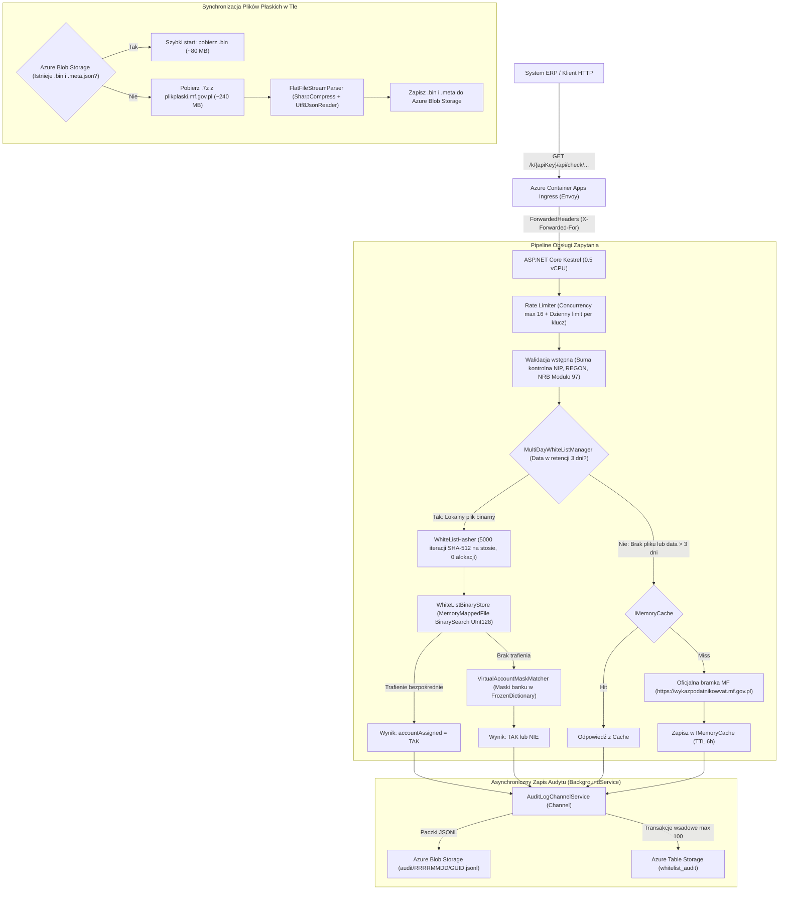

# Biała Lista Podatników VAT API (.NET 10 / Azure Container Apps)

Wysokowydajny, zoptymalizowany pod kątem minimalnego zużycia pamięci i CPU mikroserwis w **.NET 10 (ASP.NET Core Minimal API)**, kompatybilny 1:1 z oficjalnymi endpointami weryfikacji rachunków bankowych (**metoda `check`**) Wykazu Podatników VAT Ministerstwa Finansów (MF).

Projekt został zaprojektowany z myślą o hostingu w środowisku bezserwerowym **Azure Container Apps** (plan Consumption: `0.5 vCPU`, `1.0 GiB RAM`, autoskalowanie `0..2`) oraz bezpośredniej integracji z systemami księgowo-finansowymi i ERP (np. Comarch, SAP, Enova365, Symfonia).

---

## 1. Kluczowe cechy i niezmienniki architektoniczne

* **Zero alokacji w gorącej ścieżce (Hot-Path Zero-Alloc):**
  Obliczanie 5000 iteracji SHA-512 (`WhiteListHasher.ComputeTruncatedHash`) odbywa się wyłącznie na stosie (`stackalloc byte[64]`, `stackalloc byte[128]`) z użyciem `SHA512.HashData`. Brak alokacji obiektów na stercie GC w trakcie obsługi zapytania weryfikacyjnego.
* **Reprezentacja skrótów i wyszukiwanie binarne (`UInt128`):**
  Skróty SHA-512 z pliku płaskiego MF są obcinane do pierwszych 16 bajtów (128 bitów) i zapisywane jako `UInt128` w formacie **Big-Endian**, co zachowuje identyczny porządek sortowania jak tekst szesnastkowy. Pliki `.bin` są mapowane do pamięci wirtualnej przez `MemoryMappedFile` i przeszukiwane przez `ReadOnlySpan<UInt128>.BinarySearch()` w czasie poniżej 1 µs.
* **Wyszukiwanie masek rachunków wirtualnych:**
  Maski rachunków wirtualnych są grupowane po 4-cyfrowym kodzie rozliczeniowym banku w `FrozenDictionary<uint, string[]>`. Sprawdzane są wyłącznie maski przypisane do danego banku, eliminując zbędne hashowanie.
* **Strumieniowe przetwarzanie pliku płaskiego:**
  Archiwa `.7z` z serwerów MF są rozpakowywane w locie (`SharpCompress 0.48.0`) i parsowane strumieniowo przez `Utf8JsonReader` na buforze 64 KB z `ArrayPool<byte>.Shared`.
* **Retencja 3 dni i Fallback do API MF:**
  Aplikacja utrzymuje retencję lokalnych plików `.bin` dla 3 ostatnich dni wg strefy `Europe/Warsaw`. Jeśli zapytanie dotyczy starszej daty lub plik na bieżący dzień nie został jeszcze opublikowany przez MF po północy, następuje automatyczne odpytanie oficjalnego API MF z buforowaniem w `IMemoryCache` (TTL 6h).
* **Niezależność od nagłówków HTTP:**
  Systemy ERP nie muszą przesyłać własnych nagłówków (np. `X-Api-Key`). Klucz klienta może być przekazany w ścieżce URL (`/k/{apiKey}/api/check/...`), parametrze query (`?apiKey=...`) lub rozliczany po adresie IP klienta (z pełną obsługą `X-Forwarded-For` za Ingress ACA).
* **Asynchroniczny audyt należytej staranności:**
  Każda weryfikacja generuje unikalny `requestId` i trafia do nieblokującego kanału `Channel<AuditLogEntry>`, który zapisuje paczki do **Azure Blob Storage** (`.jsonl`) oraz transakcyjnie do **Azure Table Storage** jako dowód dochowania należytej staranności przed organami skarbowymi.

---

## 2. Diagram Architektury



---

## 3. Specyfikacja API

### 3.1. Weryfikacja po numerze NIP

```http
GET /api/check/nip/{nip}/bank-account/{bankAccount}?date=YYYY-MM-DD
GET /k/{apiKey}/api/check/nip/{nip}/bank-account/{bankAccount}?date=YYYY-MM-DD
```

* **Parametry ścieżki:**
  - `apiKey` *(opcjonalny)* – identyfikator klienta zdefiniowany w konfiguracji.
  - `nip` – 10-cyfrowy numer NIP.
  - `bankAccount` – 26-cyfrowy numer rachunku bankowego w formacie NRB (bez spacji).
* **Parametry query:**
  - `date` *(opcjonalny)* – data weryfikacji w formacie `YYYY-MM-DD` (domyślnie: bieżąca data wg czasu polskiego `Europe/Warsaw`).

#### Przykład żądania:
```bash
curl -X GET "https://whitelist.twojadomena.pl/k/klucz-klienta-standard/api/check/nip/5260250995/bank-account/02102010260000140201648043?date=2026-10-14"
```

#### Przykład odpowiedzi (200 OK):
```json
{
  "result": {
    "accountAssigned": "TAK",
    "requestDateTime": "14-10-2026 19:30:15",
    "requestId": "a7b3c2e1f4094d128b"
  }
}
```

---

### 3.2. Weryfikacja po numerze REGON

```http
GET /api/check/regon/{regon}/bank-account/{bankAccount}?date=YYYY-MM-DD
GET /k/{apiKey}/api/check/regon/{regon}/bank-account/{bankAccount}?date=YYYY-MM-DD
```

* **Parametry ścieżki:**
  - `regon` – 9- lub 14-cyfrowy numer REGON podmiotu.
  - Pozostałe parametry identyczne jak dla NIP.

---

### 3.3. Sonda diagnostyczna i gotowości (`/healthz`)

```http
GET /healthz
```

Służy jako **Readiness** oraz **Liveness probe** w Azure Container Apps / Kubernetes:
* **`200 OK` (Healthy):** Zwracany, gdy co najmniej jeden dzień danych został w pełni załadowany do pamięci.
* **`503 Service Unavailable` (Starting):** Zwracany w trakcie rozruchu kontenera, zanim dane zostaną pobrane i zmapowane. Dzięki temu Ingress nie kieruje ruchu produkcyjnego do niegotowego kontenera.

```json
{
  "status": "Healthy",
  "loadedDates": ["20261014", "20261013", "20261012"],
  "memoryAllocatedMb": 24.51,
  "machineTime": "2026-10-14T17:35:00.0000000Z"
}
```

---

### 3.4. Kody błędów

Format i kody błędów są zgodne ze specyfikacją techniczną Ministerstwa Finansów:

| Kod błędu | Status HTTP | Opis |
| :--- | :--- | :--- |
| `WL-113` | `400 Bad Request` | Niepoprawny numer NIP (błędna długość, znaki lub suma kontrolna). |
| `WL-114` | `400 Bad Request` | Niepoprawny numer REGON (błędna długość 9/14 cyfr lub suma kontrolna). |
| `WL-115` | `400 Bad Request` | Niepoprawny rachunek bankowy NRB (błędna długość 26 cyfr lub suma kontrolna Modulo 97). |
| `WL-111` | `400 Bad Request` | Niepoprawny format daty (wymagany `YYYY-MM-DD`). |
| `RATE-LIMIT` | `429 Too Many Requests` | Przekroczono dzienny limit zapytań dla danego klucza/IP lub serwer przetwarza więcej niż 16 równoległych zapytań. |
| `WL-500` | `502 Bad Gateway` | Błąd komunikacji z oficjalną bramką Ministerstwa Finansów w trybie Fallback. |

---

## 4. Konfiguracja i zmienne środowiskowe

Konfiguracja aplikacji może być przekazywana przez plik `appsettings.json` lub bezpośrednio przez zmienne środowiskowe kontenera:

| Zmienna środowiskowa | Domyślna wartość | Opis |
| :--- | :--- | :--- |
| `MF_API_BASE_URL` | `https://wykazpodatnikowvat.mf.gov.pl/` | Adres oficjalnego API Wykazu Podatników VAT do zapytań Fallback. |
| `BLOB_STORAGE_URI` | *(brak)* | URI kontenera Azure Blob Storage z wygenerowanymi plikami `.bin` i logami audytu. |
| `TABLE_STORAGE_URI` | *(brak)* | URI usługi Azure Table Storage do logowania audytowego. |
| `AUDIT_TABLE_NAME` | `whitelist_audit` | Nazwa tabeli w Table Storage. |
| `CLIENT_QUOTAS` | *(standard=1000, premium=50000)* | Dzienne limity zapytań per klucz. Format: `klucz1:1000,klucz2:50000;klucz3=100000`. |
| `DOTNET_GCHeapHardLimit` | `0x30000000` (768 MB) | Twardy limit pamięci sterty GC (ochrona przed OOM w kontenerze 1.0 GiB). |
| `TZ` | `Europe/Warsaw` | Strefa czasowa kontenera. |

---

## 5. Wdrożenie w Azure Container Apps

### 5.1. Wymagania dotyczące zasobów
* **vCPU:** `0.5`
* **RAM:** `1.0 GiB`
* **Skalowanie:** `0..2` replik (skalowanie do zera dozwolone – start z Azure Blob Storage trwa ~1–2 sekundy).
* **Tożsamość zarządzana (Managed Identity):**
  Wymagane uprawnienia RBAC dla tożsamości kontenera w Azure Storage:
  - `Storage Blob Data Contributor`
  - `Storage Table Data Contributor`

### 5.2. Wdrożenie przez Azure CLI
```bash
az containerapp up \
  --name ca-whitelist-api \
  --resource-group rg-whitelist-pl \
  --location polandcentral \
  --source . \
  --ingress external \
  --target-port 8080 \
  --env-vars \
    BLOB_STORAGE_URI="https://mystorage.blob.core.windows.net/whitelist" \
    TABLE_STORAGE_URI="https://mystorage.table.core.windows.net/" \
    CLIENT_QUOTAS="erp-partner:50000,sklep-online:10000"
```

### 5.3. Ciągła integracja i wdrożenie (CI/CD)
W katalogu `.github/workflows/` przygotowane są dwa przepływy GitHub Actions:
- **`ci.yml`**: Uruchamiany przy każdym Pull Requeście i wypchnięciu do gałęzi `main`. Przywraca pakiety, kompiluje projekt w konfiguracji `Release` i uruchamia 58 testów jednostkowych xUnit z raportem pokrycia kodu.
- **`deploy.yml`**: Uruchamiany automatycznie po przejściu testów na gałęzi `main` – loguje się do Azure przy użyciu tożsamości federacyjnej OIDC (`azure/login@v2`) i wdraża nową wersję do Azure Container Apps.

---

## 6. Uruchomienie lokalne i testy

### Wymagania:
* [.NET 10 SDK](https://dotnet.microsoft.com/download/dotnet/10.0)

### Uruchomienie testów jednostkowych:
```bash
dotnet test
```

### Uruchomienie serwera lokalnie:
```bash
dotnet run --project WhiteListApi.csproj
```
Serwer nasłuchuje domyślnie pod adresem `http://localhost:8080`.

### Budowanie obrazu Docker lokalnie:
```bash
docker build -t whitelist-api:latest .
docker run -p 8080:8080 -e CLIENT_QUOTAS="test-key:1000" whitelist-api:latest
```
